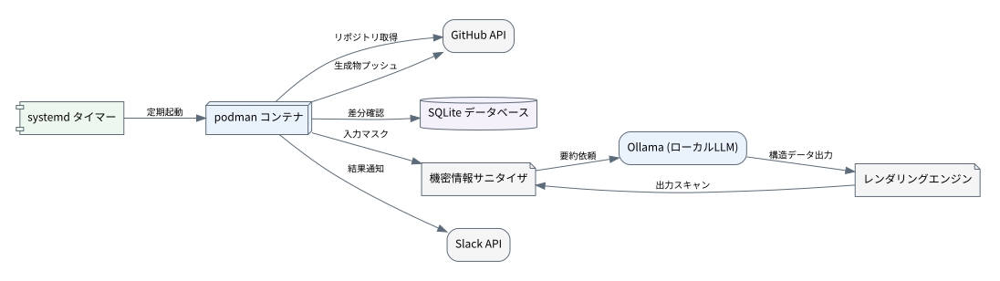

# repo-atlas

🔒 非公開リポジトリ

## 概要

非公開GitHubリポジトリのソースをローカルLLMで解析し、機密情報を除去した概要と構成図を毎日自動生成・公開する目録ツール。

## 主な機能

- リポジトリのソースコードから概要・機能・技術スタックをLLMで抽出
- IPアドレスやトークンなどの機密情報を自動マスク
- Jinja2テンプレートとGraphvizでMarkdownとSVG構成図を生成
- gitleaksによる出力スキャンで漏洩リスクを検出
- 変更のあるリポジトリのみ再解析する差分処理
- 処理結果や異常をSlackへ通知

## 技術スタック

Python / podman / SQLite / Ollama / Jinja2 / Graphviz / gitleaks / Slack API / GitHub API

## 構成図

## 更新情報

- 最終更新日: 2026-11-03
- 最後にマージされた改修: 2026-10-21 再解析ループを修正し、AWS ARNとアカウントIDのマスク機能を追加

---

[← 一覧に戻る](../../README.md) ・ このページは [repo-atlas](../../README.md) が自動生成しています。
